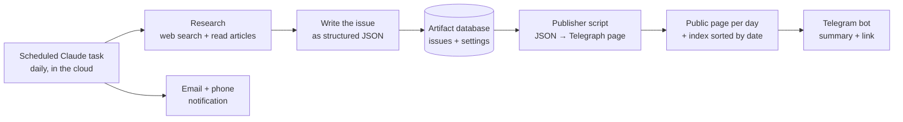

# Daily Briefs: Tokenwise & FinShorts

Two self-running daily newsletters I built for myself as a product manager. Every morning an AI agent researches the news, writes a 5–10 minute issue, publishes it as a public web page, and sends it to my phone on Telegram. Nothing runs on my laptop, and no server or database had to be set up.

| | **Tokenwise** | **FinShorts** |
| --- | --- | --- |
| Topic | AI: models, agents, research, policy, India | Fintech & finance: funding, launches, regulation |
| Arrives | 8:40 AM IST | 8:20 AM IST |
| Sections | 60-second brief · What happened · Who's winning by use case · Learn one thing · Quiz | In 60 seconds · What happened · Rules & regulators · Money raised · Numbers to know · Concept of the day · Quiz |
| Curriculum | 43 lessons, from how models work to AI product strategy | 46 lessons, from the repo rate to UPI, lending, DPDP and seller payouts |
| Read it | [All issues](https://telegra.ph/Tokenwise-all-issues-10-27) | [All issues](https://telegra.ph/FinShorts-all-issues-10-27) |

## How it works



1. **Schedule.** A Claude Code routine fires at a fixed time in Asia/Kolkata and starts a fresh cloud session. The full instructions it follows are in each product's `prompt.md`.
2. **Research.** The agent searches the last 24 hours of news, reads the actual articles, prefers primary sources, and flags anything unconfirmed. Every claim links to a source.
3. **Write.** It writes the issue as strict JSON (title, TL;DR, news, concept lesson, quiz, sources). The lesson advances through a fixed syllabus, so the reader never sees the same concept twice.
4. **Store.** Issues live in a claude.ai artifact's built-in database, one document per date. Old issues are never deleted. The same database holds the publisher script and the delivery settings.
5. **Publish.** A small Python script (`publisher/*.py`, standard library only) turns each issue into a [Telegraph](https://telegra.ph) page and rebuilds an index page sorted by date. Pages are public and open without a login. Missed days are backfilled automatically.
6. **Deliver.** A Telegram bot sends the headline, three key points and the link. The run's final summary also goes out as an email and push notification, with any failure stated at the top.

## Repository layout

```
tokenwise/
  prompt.md               the daily task's full instructions (template)
  publisher/tw_publish.py JSON issue → Telegraph page + date index
  reader/index.html       in-app reader: date rail, archive, concept library, interactive quiz
finshorts/
  prompt.md
  publisher/fin_publish.py
  reader/index.html       in-app reader: date strip, archive
```

## Design choices

- **Telegraph for reading.** The in-app reader needs a claude.ai login, which a work account on a phone may not allow. Telegraph pages open instantly inside Telegram, need no account, and look clean on mobile.
- **Data, not HTML, from the model.** The agent writes JSON in a fixed schema and a deterministic script renders it, so every issue looks the same and the layout can't drift.
- **Secrets stay out of prompts.** Bot tokens and the Telegraph token live in the artifact's private database and are read at run time. They never appear in the prompt or this repo.
- **Fail loudly, not silently.** If Telegraph or Telegram is unreachable, the run still stores the issue and says exactly what failed in the notification.
- **Idempotent runs.** Running a task twice on the same day doesn't create a duplicate. It publishes and sends what's missing.

## Run your own

1. Create two Telegram bots with [@BotFather](https://t.me/BotFather) and send each one a message.
2. In Claude, create an artifact with the `db` capability (either `reader/index.html` works) and store, in collection `meta`:
   - `publisher`: `{ "script": "<contents of the publisher .py>" }`
   - `telegram`: `{ "bot_token": "...", "chat_id": null }`
3. Fill in the `{{placeholders}}` in `prompt.md` and create a daily scheduled task (routine) with it, with notifications on.
4. Fire it once to test. The first run creates the Telegraph account and index page and finds your chat id.

## Built with

Claude Code (scheduled cloud routines, web search, artifact database) · Python 3 standard library · Telegraph API · Telegram Bot API
